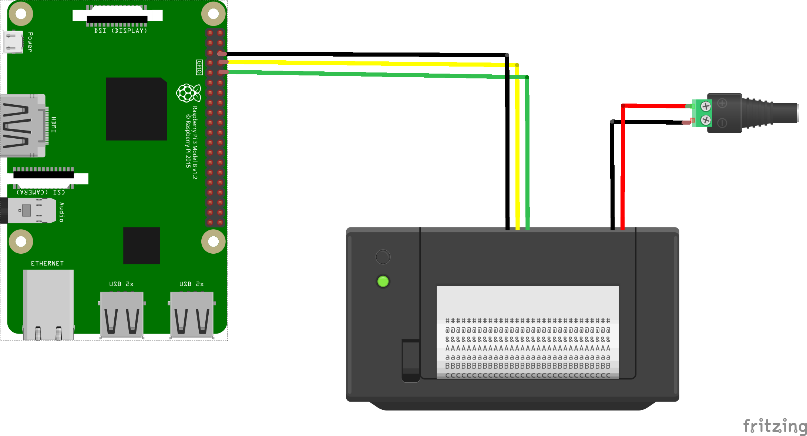

<h1>Using the thermal printer with a Raspberry pi to print bitmap images</h1>

<h2>STEP 1: software installation</h2>
power on the raspberry pi and open the terminal 

set up a virtual environment and start it up. You kind find out more on virtual enviroments [here](https://github.com/kingston-hackSpace/Virtual-Environments__RaspberryPi).

```python3 -m venv PROJECT_NAME```

```source PROJECT_NAME/bin/activate```

Within the virtual environment we can install the libraries and dependencies to allow printing from the raspberry pi.

1. Install the wheel Using

```pip install wheel```

Details on the wheel and why it's need can be found [here](https://stackoverflow.com/questions/53204916/what-is-the-meaning-of-failed-building-wheel-for-x-in-pip-install)

2. Install the dependencies and upgrade pip

```sudo apt install gcc libcups2-dev python3-dev```

```pip install --upgrade pip```

3. Install pycups

```pip install pycups```

4. install the adafruit thermal printer library

```pip3 install adafruit-circuitpython-thermal-printer```

5. Install the printer. The guide can be found [here](https://cdn-learn.adafruit.com/downloads/pdf/networked-thermal-printer-using-cups-and-raspberry-pi.pdf)

<h2>STEP 2: hardware setup</h2>



You will need:

- Thermal printer
- 5V Power supply with wire connectors
- Raspberry pi board 

set up the printer with the RX and TX pins reversed (RX to TX) (TX to RX) follow the fritzing diagram above. We use the UART serial pins on the raspberry pi and connect to the thermal printer over a serial connection.

| Raspberry pi | Thermal printer |
| --- | --- |
| GPIO 6 | Ground |
| GPIO 8 | TX (yellow) |
| GPIO 10 | RX (green) |


<h2>STEP 3: running the script</h2>

Download the attached script to the project folder. Find an image you want to use. Grab the image file path and add it to the script. Change line 5 to match the name of the file.

Run the command below once everything is in place...

```python3 print bitmap_test.py```

Your image should print out straight away.

More on the pycups terminal can be found [here](https://www.techradar.com/how-to/computing/how-to-turn-the-raspberry-pi-into-a-wireless-printer-server-1312717/2)